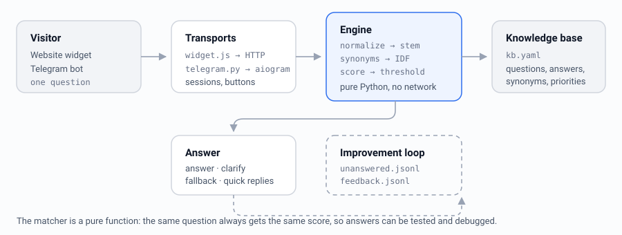

# faqbot

**English** | [Русский](README.ru.md)

**A small, self-hosted FAQ chatbot that answers from your own knowledge base — offline, without an LLM.**

[](https://github.com/egerasimovgerasimov-cmyk/faqbot/actions/workflows/ci.yml)
[](https://www.python.org/)
[](LICENSE)

<p align="center">
  
</p>

Most "chatbot" projects wrap an LLM API: they need a key, cost money per
message, hallucinate, and send your customers' questions to a third party.
For an FAQ — prices, opening hours, documents, refund policy — that is
overkill. faqbot does one thing well: it finds the best answer in a curated
knowledge base and knows when it does not know.

It grew out of a chat bot I built for a real children's summer camp, where it
was embedded into a WordPress site and answered parents' questions. This
repository is the engine, extracted from the plugin, cleaned up and made
reusable.

## Why it is interesting

- **Runs anywhere.** Pure Python, one dependency (PyYAML). No model download,
  no GPU, no network calls, no API keys.
- **Understands Russian inflections.** «путёвка», «путёвки» and «путёвок» share
  a stem; synonyms like `тур = путёвка` are configurable. English works too.
- **Honest about uncertainty.** Below the confidence threshold it returns a
  fallback with related questions instead of inventing an answer.
- **Asks instead of guessing.** Two near-equal matches produce a clarifying
  question with clickable options.
- **Keeps the thread.** A follow-up like «а сколько дней?» is expanded with the
  previous question before searching.
- **Everything is testable.** The matcher is a pure function; the Telegram
  layer is split from aiogram so message handling is tested without a token.

## Quick start

```bash
python -m venv .venv
source .venv/bin/activate          # Windows: .venv\Scripts\activate
pip install -e ".[api]"

faqbot --kb examples/camp/kb.yaml ask "сколько стоит путёвка"
faqbot --kb examples/camp/kb.yaml chat
faqbot --kb examples/camp/kb.yaml serve --port 8000
```

Open <http://127.0.0.1:8000> for the demo page with the widget, or
<http://127.0.0.1:8000/docs> for the generated OpenAPI documentation.

```console
$ faqbot --kb examples/camp/kb.yaml ask "а сколько дней длится смена"
Одна смена длится 14 дней, включая день заезда и день выезда.
  [answer, score=0.71, qa_id=6]
```

Useful commands:

| Command | What it does |
| --- | --- |
| `faqbot ask "..."` | Answer one question, `--json` for machine-readable output |
| `faqbot chat` | Interactive dialogue in the terminal |
| `faqbot search "..."` | Show raw match scores, useful when tuning the knowledge base |
| `faqbot validate` | Check the KB for duplicates, bad thresholds and missing fields |
| `faqbot serve` | REST API, demo page and static widget |
| `faqbot telegram` | Long-polling Telegram bot |

## Embed the widget

The widget is a single script tag. It injects its own styles, keeps a session
in `localStorage` and calls the API:

```html
<script
  src="https://bot.example.com/widget.js"
  data-api="https://bot.example.com"
  defer
></script>
```

Colours and texts come from the knowledge base (`bot.name`, `bot.greeting`,
`bot.operator_url`, `quick`). There is no build step and no framework.

## Telegram bot

1. Create a bot with [@BotFather](https://t.me/BotFather) and copy the token.
2. Run:

```bash
pip install -e ".[telegram]"
export FAQBOT_TELEGRAM_TOKEN="123456:ABC..."
faqbot --kb examples/camp/kb.yaml telegram
```

Inline buttons reuse the same related-question logic as the widget, and
`/help`, `/reset` are handled. Sessions are in memory: restarting the process
starts new dialogues.

## Knowledge base

A knowledge base is one YAML file (JSON is also accepted):

```yaml
bot:
  name: Солнышко
  greeting: Привет! Спросите про путёвки и смены.
  fallback: Не нашёл ответа — напишите оператору.
  threshold: 0.45                 # confidence required to answer
  clarify_gap: 0.06               # how close two matches must be to ask back
  operator_label: Написать оператору
  operator_url: https://t.me/example
  replies:                        # optional overrides for small talk
    thanks: Рад помочь!

synonyms:
  - "путёвка = тур, поездка, путевка"

quick:
  - label: Сколько стоит путёвка?
    query: Сколько стоит путёвка?

qa:
  - id: 1                         # optional, auto-assigned
    question: Сколько стоит путёвка?
    answer: От 42 000 до 58 000 ₽ за 14 дней.
    keywords: цена стоимость          # extra words that should match
    category: Путёвки                 # used for context and suggestions
    priority: 10                      # small ranking bonus, 0–10
```

`faqbot validate --strict` exits with code 1 on warnings, so it can guard CI.
Two complete examples live in [`examples/camp`](examples/camp/kb.yaml)
(Russian) and [`examples/support`](examples/support/kb.en.yaml) (English).

## How matching works

1. The message is lowercased, `ё → е`, punctuation is dropped and stop words
   («сколько», «пожалуйста», ...) are removed.
2. Each word is reduced to a stem by stripping common endings. Synonyms map
   variants to one canonical stem.
3. Tokens get an IDF weight: a word that appears in many questions is less
   useful than a rare one.
4. For every QA item the engine combines:
   - coverage of the user's message (`0.62`),
   - coverage of the QA question (`0.23`),
   - an exact/substring bonus (`0.15`),
   - small bonuses for `priority` and matching `category`.
5. If the best score is below `threshold`, the answer is a fallback with the
   closest questions. If the top two are within `clarify_gap`, the bot asks a
   clarifying question. An exact question match always scores `1.0`.

The point is not to beat a neural network on open-domain questions. The point
is to be predictable, debuggable and cheap on a closed FAQ — and to know when
to hand the visitor to a human.

## HTTP API

| Method | Path | Description |
| --- | --- | --- |
| `GET` | `/api/health` | Status and number of QA entries |
| `GET` | `/api/config` | Bot name, greeting, quick replies, operator link |
| `POST` | `/api/ask` | `{"message": "...", "session": "..."}` → answer, score, quick replies |
| `GET` | `/api/search?q=...` | Raw matches — the same view as `faqbot search` |
| `POST` | `/api/feedback` | `{"session": "...", "qa_id": 1, "value": 1}` |

Unanswered questions and feedback are appended to JSONL files (`var/` by
default) so the knowledge base can be improved from real traffic. Sessions live
in memory: run a single worker, or replace the session store if you need to
scale out.

## Docker

```bash
docker build -t faqbot .
docker run --rm -p 8000:8000 -v "$PWD/examples:/app/examples" faqbot
```

## Project layout

```
src/faqbot/
  text.py       normalisation, stemming, synonyms
  kb.py         knowledge base model, YAML/JSON loader, validation
  engine.py     scoring, clarifications, follow-up context, sessions
  intents.py    greetings, thanks, "call a human" and other small talk
  api.py        FastAPI app and widget hosting
  telegram.py   pure message handler + thin aiogram wiring
  cli.py        ask / chat / search / validate / serve / telegram
  widget/       vanilla JS widget, demo page, styles
tests/          pytest suite, no network required
examples/       Russian camp KB and English SaaS KB
```

## Development

```bash
pip install -e ".[api,telegram,dev]"
pytest
ruff check .
```

CI runs the tests on Python 3.10, 3.11 and 3.12 plus lint and a wheel build.

## Limitations and ideas

- The stemmer is deliberately simple; it is not a lemmatiser. For languages
  with richer morphology, swap `text.tokenize` for a real analyser.
- Matching is lexical. A future version could blend in embeddings behind the
  same `Bot.find` interface, while keeping the offline default.
- Session state is in memory. Redis-backed sessions would allow multiple
  workers.
- Unanswered questions are logged but not clustered. Grouping them into
  suggested new FAQ entries would close the improvement loop.

## License

MIT — see [LICENSE](LICENSE). The demo knowledge bases are fictional.
