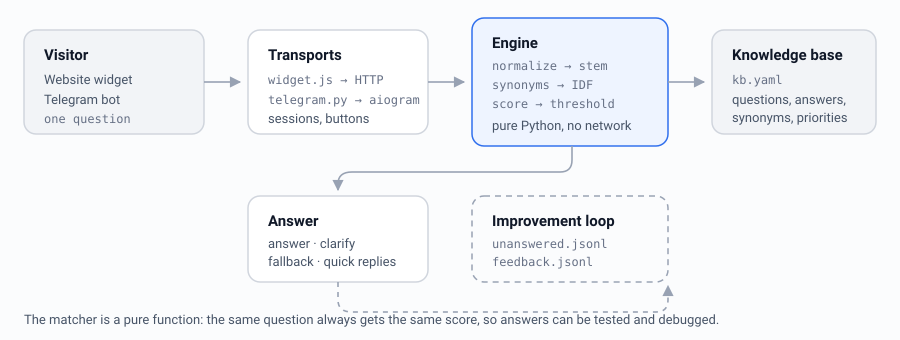

# faqbot

[English](README.md) | **Русский**

**Небольшой чат-бот для ответов по своей базе знаний — офлайн, без LLM.**

[](https://github.com/egerasimovgerasimov-cmyk/faqbot/actions/workflows/ci.yml)
[](https://www.python.org/)
[](LICENSE)

<p align="center">
  
</p>

Большинство «чат-ботов» — это обёртка над LLM API: нужен ключ, каждое сообщение
стоит денег, бот выдумывает факты, а вопросы клиентов уходят третьей стороне.
Для FAQ — цены, часы работы, документы, правила возврата — это избыточно.
faqbot делает одну вещь хорошо: находит лучший ответ в подготовленной базе
знаний и честно признаётся, когда ответа нет.

Проект вырос из чат-бота для детского летнего лагеря: он был встроен в сайт на
WordPress и отвечал родителям. Этот репозиторий — движок, вынутый из плагина,
почищенный и сделанный переиспользуемым.

## Чем интересен

- **Работает где угодно.** Чистый Python, одна зависимость (PyYAML). Ни
  скачивания моделей, ни GPU, ни сетевых вызовов, ни API-ключей.
- **Понимает русские словоформы.** «путёвка», «путёвки» и «путёвок» дают одну
  основу; синонимы вида `тур = путёвка` настраиваются. Английский тоже
  поддерживается.
- **Честен в неопределённости.** Ниже порога уверенности — не выдуманный ответ,
  а запасной текст с близкими вопросами.
- **Спрашивает, а не угадывает.** Если два ответа почти равны, бот задаёт
  уточняющий вопрос с кнопками.
- **Помнит контекст.** Уточнение вроде «а сколько дней?» дополняется предыдущим
  вопросом перед поиском.
- **Всё тестируется.** Сопоставление — чистая функция; слой Telegram отделён от
  aiogram, поэтому обработка сообщений тестируется без токена.

## Быстрый старт

```bash
python -m venv .venv
source .venv/bin/activate          # Windows: .venv\Scripts\activate
pip install -e ".[api]"

faqbot --kb examples/camp/kb.yaml ask "сколько стоит путёвка"
faqbot --kb examples/camp/kb.yaml chat
faqbot --kb examples/camp/kb.yaml serve --port 8000
```

Откройте <http://127.0.0.1:8000> — демо-страница с виджетом, или
<http://127.0.0.1:8000/docs> — сгенерированная OpenAPI-документация.

```console
$ faqbot --kb examples/camp/kb.yaml ask "а сколько дней длится смена"
Одна смена длится 14 дней, включая день заезда и день выезда.
  [answer, score=0.71, qa_id=6]
```

Полезные команды:

| Команда | Что делает |
| --- | --- |
| `faqbot ask "..."` | Ответ на один вопрос, `--json` — машиночитаемый вывод |
| `faqbot chat` | Интерактивный диалог в терминале |
| `faqbot search "..."` | Показать сырые оценки совпадений — удобно при настройке базы |
| `faqbot validate` | Проверить базу: дубли, порог, обязательные поля |
| `faqbot serve` | REST API, демо-страница и статический виджет |
| `faqbot telegram` | Telegram-бот на long polling |

## Встроить виджет

Виджет подключается одним тегом. Он сам добавляет стили, хранит сессию в
`localStorage` и обращается к API:

```html
<script
  src="https://bot.example.com/widget.js"
  data-api="https://bot.example.com"
  defer
></script>
```

Цвета и тексты берутся из базы знаний (`bot.name`, `bot.greeting`,
`bot.operator_url`, `quick`). Ни сборки, ни фреймворка.

## Telegram-бот

1. Создайте бота у [@BotFather](https://t.me/BotFather) и скопируйте токен.
2. Запустите:

```bash
pip install -e ".[telegram]"
export FAQBOT_TELEGRAM_TOKEN="123456:ABC..."
faqbot --kb examples/camp/kb.yaml telegram
```

Инлайн-кнопки используют ту же логику связанных вопросов, что и виджет;
`/help` и `/reset` обрабатываются. Сессии хранятся в памяти: перезапуск процесса
начинает новые диалоги.

## База знаний

База знаний — один YAML-файл (JSON тоже принимается):

```yaml
bot:
  name: Солнышко
  greeting: Привет! Спросите про путёвки и смены.
  fallback: Не нашёл ответа — напишите оператору.
  threshold: 0.45                 # нужная уверенность для ответа
  clarify_gap: 0.06               # насколько близки два ответа для уточнения
  operator_label: Написать оператору
  operator_url: https://t.me/example
  replies:                        # необязательные ответы на small talk
    thanks: Рад помочь!

synonyms:
  - "путёвка = тур, поездка, путевка"

quick:
  - label: Сколько стоит путёвка?
    query: Сколько стоит путёвка?

qa:
  - id: 1                         # необязательно, назначится автоматически
    question: Сколько стоит путёвка?
    answer: От 42 000 до 58 000 ₽ за 14 дней.
    keywords: цена стоимость          # дополнительные слова для поиска
    category: Путёвки                 # контекст и подсказки
    priority: 10                      # небольшой бонус к ранжированию, 0–10
```

`faqbot validate --strict` завершается с кодом 1 при предупреждениях, поэтому
его можно поставить в CI. Два полных примера лежат в
[`examples/camp`](examples/camp/kb.yaml) (русский) и
[`examples/support`](examples/support/kb.en.yaml) (английский).

## Как работает сопоставление

1. Сообщение приводится к нижнему регистру, `ё → е`, пунктуация убирается,
   стоп-слова («пожалуйста», «подскажите», ...) отбрасываются.
2. Каждое слово сводится к основе отсечением частых окончаний. Синонимы
   приводят варианты к одной канонической основе.
3. Токены получают вес IDF: слово, встречающееся во многих вопросах, полезнее
   редкого.
4. Для каждой пары «вопрос—ответ» движок складывает:
   - покрытие сообщения пользователя (`0.62`),
   - покрытие вопроса из базы (`0.23`),
   - бонус за точное совпадение или вхождение (`0.15`),
   - небольшие бонусы за `priority` и совпадающую `category`.
5. Если лучшая оценка ниже `threshold` — запасной ответ с ближайшими вопросами.
   Если два верхних ответа ближе, чем `clarify_gap`, — уточняющий вопрос.
   Точное совпадение вопроса всегда даёт `1.0`.

Цель — не обогнать нейросеть на открытых вопросах, а быть предсказуемым,
отлаживаемым и дешёвым на закрытом FAQ — и вовремя передавать посетителя
человеку.

## HTTP API

| Метод | Путь | Описание |
| --- | --- | --- |
| `GET` | `/api/health` | Статус и число записей в базе |
| `GET` | `/api/config` | Имя бота, приветствие, быстрые вопросы, ссылка на оператора |
| `POST` | `/api/ask` | `{"message": "...", "session": "..."}` → ответ, оценка, кнопки |
| `GET` | `/api/search?q=...` | Сырые совпадения — то же, что `faqbot search` |
| `POST` | `/api/feedback` | `{"session": "...", "qa_id": 1, "value": 1}` |

Вопросы без ответа и оценки дописываются в JSONL-файлы (по умолчанию в `var/`),
чтобы базу можно было улучшать по реальному трафику. Сессии хранятся в памяти:
запускайте один воркер или замените хранилище сессий при горизонтальном
масштабировании.

## Docker

```bash
docker build -t faqbot .
docker run --rm -p 8000:8000 -v "$PWD/examples:/app/examples" faqbot
```

## Структура проекта

```
src/faqbot/
  text.py       нормализация, стемминг, синонимы
  kb.py         модель базы знаний, загрузчик YAML/JSON, валидация
  engine.py     скоринг, уточнения, контекст продолжения, сессии
  intents.py    приветствия, благодарности, «позвать человека» и другой small talk
  api.py        приложение FastAPI и раздача виджета
  telegram.py   чистый обработчик сообщений + тонкая обвязка aiogram
  cli.py        ask / chat / search / validate / serve / telegram
  widget/       виджет на чистом JS, демо-страница, стили
tests/          pytest-набор, сеть не нужна
examples/       русская база лагеря и английская база SaaS
```

## Разработка

```bash
pip install -e ".[api,telegram,dev]"
pytest
ruff check .
```

CI прогоняет тесты на Python 3.10, 3.11 и 3.12, линтер и сборку wheel.

## Ограничения и идеи

- Стеммер намеренно простой; это не лемматизатор. Для языков с богатой
  морфологией замените `text.tokenize` на настоящий анализатор.
- Сопоставление лексическое. Будущая версия может добавить эмбеддинги за тем же
  интерфейсом `Bot.find`, сохранив офлайн-режим по умолчанию.
- Состояние сессий — в памяти. Сессии в Redis позволили бы несколько воркеров.
- Вопросы без ответа логируются, но не кластеризуются. Группировка в
  предлагаемые новые записи FAQ замкнула бы цикл улучшения.

## Лицензия

MIT — см. [LICENSE](LICENSE). Демонстрационные базы знаний вымышлены.
